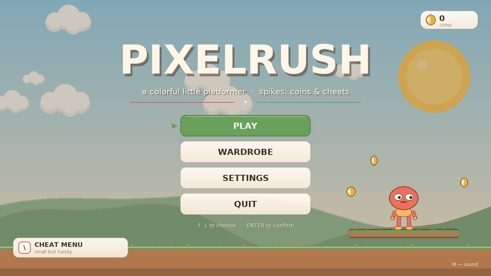
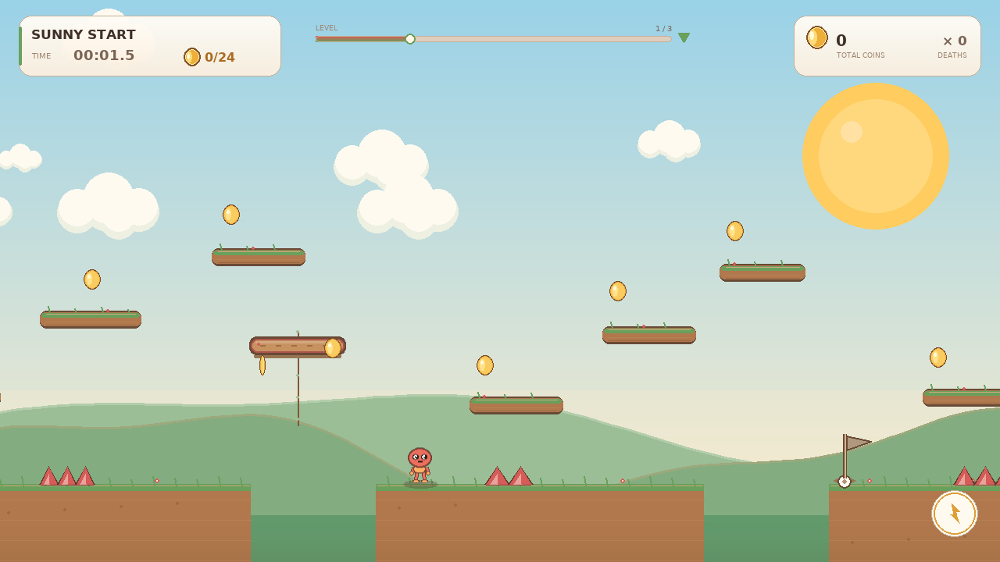

# PIXELRUSH

holy vibecoded game with CHEATS! 





## Download

1. Click the green **Code** button.
2. Choose **Download ZIP**.
3. Extract the archive.
4. Open a terminal in the extracted folder.

## Run

Install the dependency:

```bash
python3 -m pip install -r requirements.txt
```

Start the game:

```bash
python3 main.py
```

On Windows, use `python` instead of `python3` if needed.

## Requirements

- Python 3.10+
- pygame-ce

## Controls

| Key | Action |
| --- | --- |
| `A` / `D` or `←` / `→` | Move |
| `Space` / `W` / `↑` | Jump / double jump |
| `Shift` | Dash |
| `R` | Restart level |
| `Esc` | Pause |
| `Enter` | Confirm |
